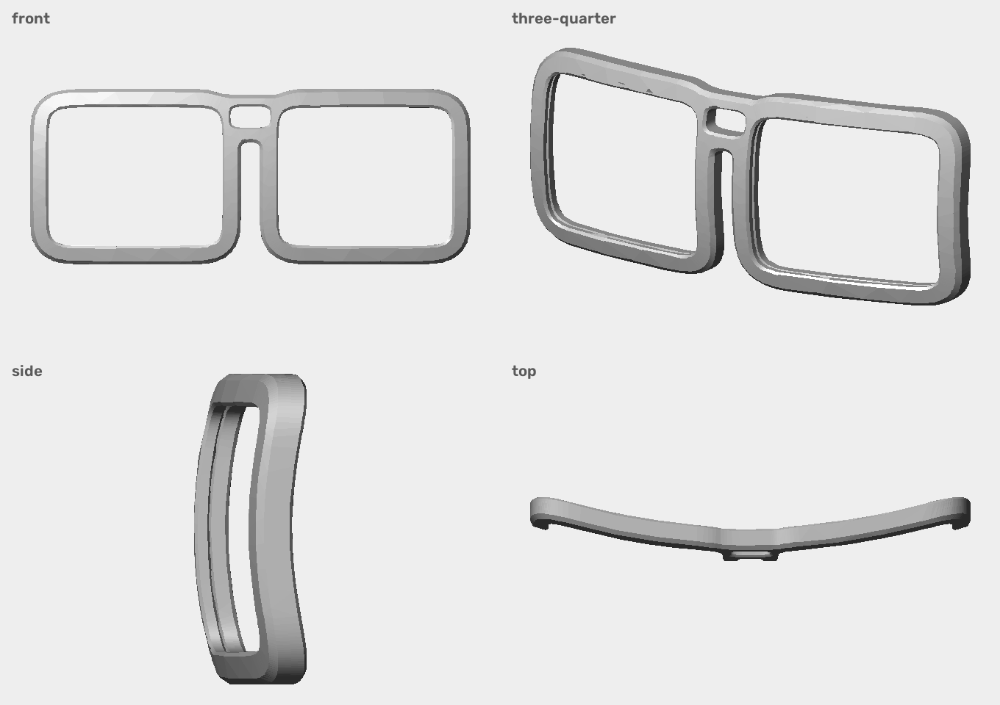
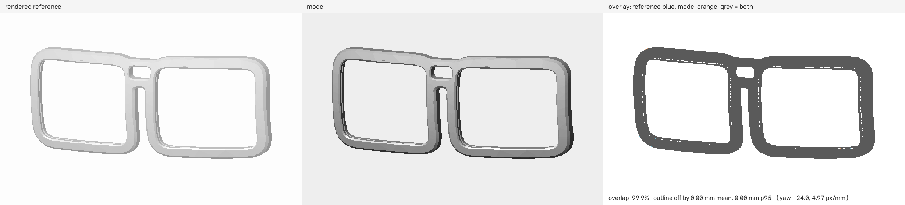

# rgeo - idea to reusable geometry

Build parametric CAD in code when your reference is a photograph rather than a
drawing, and prove afterwards how close you got.



```python
from rgeo import Shell, Torus, WallProfile, mesh_report

body = (Shell(Torus.from_radii(vertical=88.3, horizontal=220.0))
        .outer(front_outline, WallProfile(6.0).chamfer_front(1.1).chamfer_back(0.7))
        .hole(lens_left,  lens_wall)
        .hole(lens_right, lens_wall)
        .hole(bridge_window, WallProfile(6.0, outward=True).chamfer_both(0.6))
        .build())

mesh_report(body)     # {'watertight': True, 'volume_mm3': 14613.0, ...}
```

That builds in a tenth of a second and comes out watertight, with chamfers, a
lens groove and three openings - and not one boolean operation.

## Why

Code-defined CAD is attractive: dimensions become variables, the model is
diffable, and a language model can write it. Two things get in the way in
practice.

**The kernel fights you.** On a curved surface of any size, OpenCascade's
booleans and fillets fail - and mostly fail *silently*. Measured on a sphere
of R = 88 mm: the same cut returned 3920 mm³ at fuzzy tolerance 1e-4 and 2689
mm³ at 1e-3; an exact boolean returned an empty solid with no error; a union
of two lofted bodies came back at -2.4e6 mm³; `fillet()` on four spline edges
ran for over nine minutes without completing. Full list with reproductions in
[docs/WHY.md](docs/WHY.md).

**Numbers lose their pedigree.** Six months on, nobody remembers which
dimension was measured off the part, which was fitted, and which was a guess
that has been quietly load-bearing ever since.

rgeo answers both: describe walls instead of cutting them, and make every
number carry where it came from.

## Install

```bash
pip install -e ".[dev]"        # Python 3.10-3.12; cadquery has no 3.13+ wheels yet
pytest
```

## The pipeline

```
reference ──trace──> outlines ──┐
                                ├──> Shell ──> solid ──> check ──> compare
            parameters ─────────┘                                     │
                                                                      └──> mm
```

Each stage stands on its own. Use the whole chain, or just the shell builder.

### 1. Measure the reference, do not estimate it

```python
from rgeo import trace
traced = trace("product-photo.png", threshold=165, mirror=True)
outlines = traced.scaled(mm_per_px=0.09, origin=(cx, cy)).tidy()
```

`mirror=True` mirrors one half onto the other **on the mask, before any
contour is taken**, so a part that should be symmetric is - exactly.

On the project this came out of, tracing the outline rather than estimating it
moved silhouette overlap from 69.6 % to 92.0 %. It is the single change that
mattered most.

### 2. Say where every number came from

```python
from rgeo import ParamSet, Measured, Fitted, Assumed

p = ParamSet(
    lens_height = Measured(44.8, "front photo", "bounding box of the opening"),
    front_radius= Fitted(220.0, "three-quarter view", "flat optimum 220..320"),
    lens_width  = Assumed(56.0, "typical aviator boxing",
                          "nothing in a photo fixes absolute scale"),
)
p.lens_width + 1.0          # 57.0 - it is a float everywhere
print(p.table())            # markdown, grouped by provenance
p.assumptions()             # the ones a reader has to be warned about
```

### 3. Describe the walls

A feature that would normally be a cut is an offset in a wall profile:

```python
from rgeo import WallProfile

rim  = WallProfile(6.0).chamfer_front(1.1).chamfer_back(0.7)
lens = (WallProfile(6.0, outward=True)
        .chamfer_both(0.6)
        .groove(at=2.6, width=0.9, depth=0.7))     # lens bevel groove
boss = WallProfile(6.0).round_both(0.5).step(at=4.0, offset=0.8)
```

Thickness may vary across the part, which is how a boss stands proud of the
back face without a boolean:

```python
thick = np.where(np.abs(angle - 90) < 30, 10.0, 6.0)   # one entry per point
shell.outer(outline, rim, thickness=thick)
```

### 4. Pick the surface the part lies on

| | use for | trimmed faces with holes |
|---|---|---|
| `Plane()` | flat parts | yes |
| `Cylinder(r)` | single curvature | yes |
| `Sphere(r)` / `from_base_curve(6)` | lenses, domes | **no** - see below |
| `Torus.from_radii(vertical, horizontal)` | two curvatures at once | yes |

A sphere's parametrisation is singular at its pole, so an outline around the
axis cannot be expressed there. rgeo says so instead of handing back an empty
face:

```
GeometryError: Sphere.face() came out empty. If this is a Sphere, the outline
probably encloses the pole - use Torus or Cylinder instead.
```

This is not academic. A spectacle front is spherical per lens, but a 145 mm
wide front on a base-curve-6 sphere would sag 35 mm. Real fronts carry the
base curve vertically and a flatter wrap horizontally - a torus, which also
happens to be the shape whose parameter space has no pole in the way.

### 5. Check, every time

```python
from rgeo import CheckList

checks = (CheckList()
          .watertight("front", body)
          .at_least("rim width", rim_mm, 2.5)
          .between("front width", width_mm, 125, 155))
print(checks.report())
raise SystemExit(checks.exit_code())     # non-zero if anything failed
```

Watertightness is measured on the **mesh**, not the B-rep: OpenCascade will
flag a perfectly printable solid as invalid and will also call a broken one
valid. The mesh is what gets printed.

### 6. Compare against the reference, in millimetres

```python
from rgeo import fit_camera, comparison_strip

result = fit_camera(vertices, triangles, photo_mask)
print(result.summary())
# overlap  85.0%   outline off by 0.32 mm mean, 0.76 mm p95  (yaw 0.9, 4.18 px/mm)
```



Two rules keep that number honest:

- **The camera is fitted, never the geometry.** What is left over is then a
  statement about shape, not about viewpoint.
- **Millimetres, not just overlap.** IoU is brutal on anything thin: a 5 mm
  wide rim offset by half a millimetre loses ten points of overlap and reads
  like a far bigger error than it is.

And when a parameter is not constrained by the reference, `sweep` says so
rather than reporting a winner:

```
flat optimum: best and worst differ by 1.4 points, so this parameter is not
constrained by the reference
```

## What it is not

- **Not a CAD kernel.** It sits on CadQuery and OpenCascade and works around
  their weak spots; it does not replace them.
- **Not a sculpting tool.** Freeform surfacing, curvature-continuous blends
  and class-A surfaces are out of scope. OpenCascade's fillets are circular,
  therefore tangent-continuous only.
- **Not a mesh library.** It builds B-rep solids and exports STEP and STL.
- **No simulation, no CAM, no drawings.**

## Examples

```bash
python examples/eyewear/front.py        # build, export, render, check
python examples/eyewear/roundtrip.py    # render, trace it back, measure
```

`front.py` builds a complete spectacle front - three openings, chamfers, lens
groove, face-form wrap - from parameters alone. The outlines are generated,
not traced, so the repository ships without anyone else's imagery.
`roundtrip.py` exercises the measuring half: it renders the model from a
viewpoint the fitter is not told about and checks that the fitter finds it
again.

## Origin

This came out of rebuilding two real eyewear frames from photographs: half a
frame front from a photo of a SolidWorks session (92.0 % silhouette overlap),
and a complete pair from product photography (outline off by 0.32 mm frontally,
1.31 mm in a view nothing was traced from). Every workaround in here is
something that project hit, measured, and had to route around.

## Licence

MIT. See [LICENSE](LICENSE).
